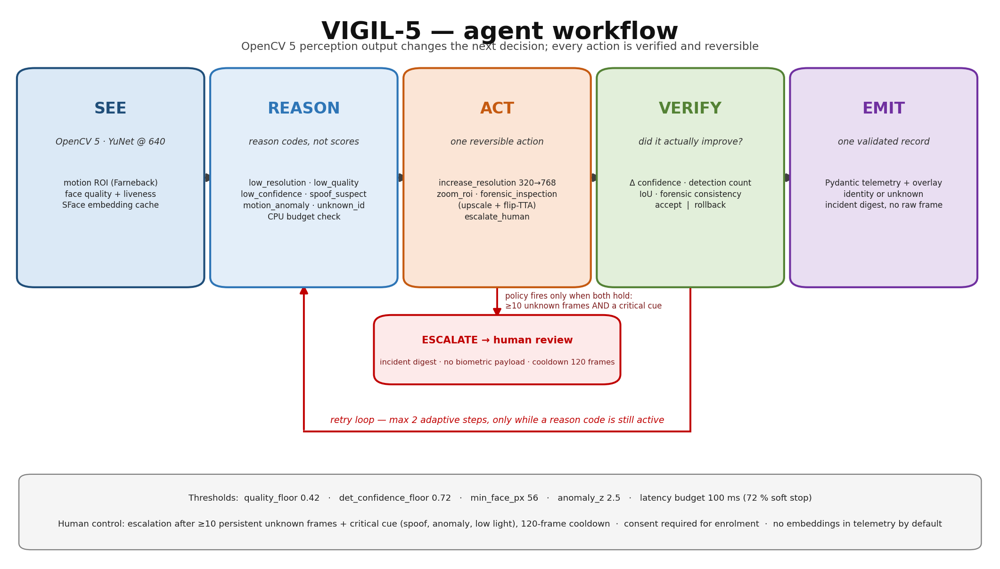
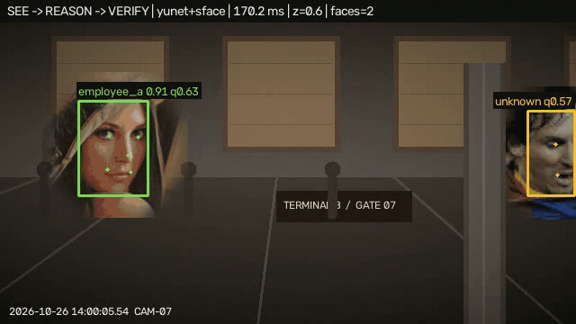
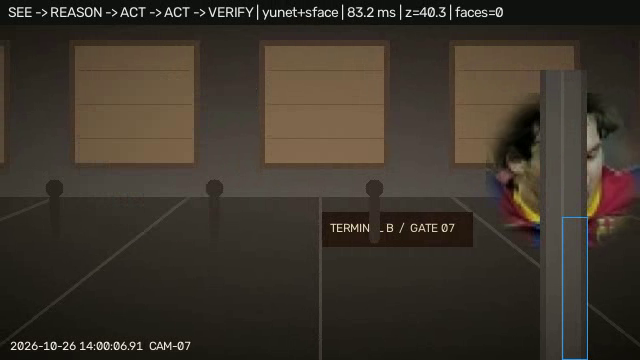
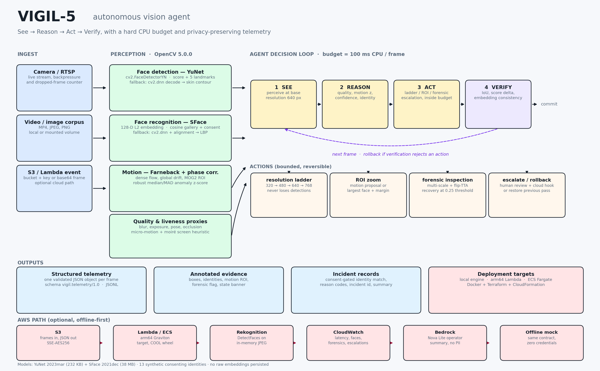

# VIGIL-5

### An autonomous, budget-aware vision agent on OpenCV 5

**OpenCV AI Competition 2026 · Track 07 · Agentic Vision**


VIGIL-5 is not a detector with a UI. It runs a closed loop —
**SEE → REASON → ACT → VERIFY** — and spends compute only when the current view
is not good enough: a resolution ladder, ROI zoom, forensic re-scan, rollback
when verification fails, and human escalation after persistent ambiguity. Every
frame emits one Pydantic-validated JSON record.

> On the same 288-frame clip, a static 320 px detector runs at **216 FPS and
> catches 0 %** of the scripted events. VIGIL-5 runs at **24.8 FPS and catches
> 100 %**, with 36 ms CPU p50 per frame. Throughput is not the product metric.



---

## For judges — the 5-minute path

| Open this | What it proves | Time |
|---|---|---|
| **[`outputs/DEVPOST_SUBMISSION.md`](outputs/DEVPOST_SUBMISSION.md)** | Full technical report: problem, architecture, OpenCV 5 implementation, AWS delivery, evaluation, limitations, responsible use | 10 min |
| **[`outputs/demo_submission.mp4`](outputs/demo_submission.mp4)** | 85 s walkthrough: loop, architecture, real 288-frame run, results, limitations | 2 min |
| **[`outputs/agent_trace.md`](outputs/agent_trace.md)** | Frame-by-frame proof that an OpenCV 5 result changed the next action, plus the human-escalation policy trace | 4 min |
| **[`outputs/benchmarks.json`](outputs/benchmarks.json)** | Raw timings, per-repetition spread, environment, quality metrics | 3 min |
| **[`TESTING.md`](TESTING.md)** | Pinned deps, exact commands, expected outputs | 2 min |
| **[`outputs/cool_evidence.json`](outputs/cool_evidence.json)** | Why no COOL/Graviton claim is made (honest probe, not assertion) | 2 min |

`outputs/DEVPOST_SUBMISSION.md` is the primary document. Every number in it is
tied to a file in this repository and a command that regenerates it.



---

## Results (measured, not estimated)

Host: x86_64, 16 logical CPUs pinned to 0–3, OpenCV threads = 1, 3 repetitions
per timing block. Full methodology and spread: `outputs/benchmarks.json`.

| Metric | VIGIL-5 (fused) | Static 320 px baseline |
|---|---:|---:|
| **Event recall** | **1.00** | **0.00** |
| Wall FPS | 24.81 | 216.33 |
| CPU p50 / p95 | 36.21 / 85.12 ms | 4.51 / 5.61 ms |
| Box F1 | 0.7303 | 0.7527 |
| Identity accuracy | 0.999 | — |
| Detection ROC-AUC | 0.9917 | — |
| Face recognition TAR @ FAR 1e-2 | 1.000 (60 pairs) | — |
| RSS after models | 134.15 MB | — |

Full agent without the fused pipeline: 20.22 FPS, 45.04 ms CPU p50, same event
recall. The 8.7× faster baseline misses every scripted event — occlusion, fast
entry, low light, blur — because it never asks for a better view.

The demo run itself (`outputs/telemetry/demo.jsonl`, 288 frames) measured 158.6 ms
mean latency on a host under load average ≈ 47, with **1 forensic frame, 2
adaptive steps, 1 rollback, 0 escalations**. Those are the numbers the video
subtitles use. See [`outputs/demo_notes.md`](outputs/demo_notes.md).

---

## Why this is agentic, not a pipeline

Frame 166 is the causal chain in one frame:

1. Farneback motion reports `z = 40.27` — a large anomaly at the right edge.
2. YuNet returns **zero faces at 640 px** (the face is behind a pillar).
3. Those two perception results raise `motion_anomaly` + `no_face_with_motion`.
4. The policy selects a **forensic recovery scan** (lower detector threshold,
   upscale + flip-TTA), then an **ROI zoom at 640 px**.
5. VERIFY finds 0 new faces and IoU 0 → the agent **rolls the frame back**
   instead of accepting a hallucinated detection.



The escalation path is a separate, deterministic trace: an unknown face with a
spoof-suspect liveness score in front of a motion anomaly escalates on the
tenth consecutive frame (`outputs/agent_trace_escalation.jsonl`). Identity
ambiguity **alone** never pages a human — in the demo the unknown visitor stays
unknown and no escalation fires. That restraint is the human-control design.

Policy thresholds: `quality_floor 0.42`, `det_confidence_floor 0.72`,
`min_face_px 56`, `anomaly_z 2.5`, `latency_budget 100 ms` (72 % soft stop),
escalation ≥ 10 unknown frames **and** a critical cue, 120-frame cooldown.

---

## Architecture



- **Perception** — OpenCV 5 `FaceDetectorYN` (YuNet) with a DNN manual-decode and
  classical fallback chain; `FaceRecognizerSF` (SFace) with DNN/LBP fallbacks;
  Farneback motion; texture/motion/moiré liveness proxy. The backend that ran is
  recorded in every telemetry row, so degradation is visible, never silent.
- **Policy** — one reversible action per step, capped at 2 adaptive steps and a
  100 ms CPU budget measured with `time.process_time()`.
- **Verification** — confidence delta, detection count, IoU and forensic
  embedding consistency; any rejected action triggers rollback.
- **Output** — `vigil.telemetry/1.0` JSON per frame, annotated MP4, incident
  digest. No raw embeddings or frames in telemetry by default.
- **AWS delivery** — base64/S3 Lambda handler, arm64 + x86 Dockerfiles, ECS
  Fargate task definitions, Terraform and CloudFormation. Offline-validated
  only; no live deployment is claimed.

---

## Quick start

```bash
git clone https://github.com/krishnakumarbhat/VIGIL.git
cd VIGIL
pip install -r requirements.txt          # OpenCV 5.0.0.93, NumPy 2.2.6, Pydantic 2.14.1

mkdir -p data/models
curl -L -o data/models/face_detection_yunet_2023mar.onnx \
  https://github.com/opencv/opencv_zoo/raw/main/models/face_detection_yunet/face_detection_yunet_2023mar.onnx
curl -L -o data/models/face_recognition_sface_2021dec.onnx \
  https://github.com/opencv/opencv_zoo/raw/main/models/face_recognition_sface/face_recognition_sface_2021dec.onnx
```

```bash
# tests: 61 passing
PYTEST_DISABLE_PLUGIN_AUTOLOAD=1 python3 -m pytest -q tests

# regenerate the 288-frame demo, annotated MP4, telemetry and summary
python3 src/generate_demo_video.py \
  --out data/demo/demo.mp4 \
  --annotated-out outputs/demo_annotated.mp4 \
  --telemetry outputs/telemetry/demo.jsonl \
  --summary outputs/demo_summary.json

# rebuild the trace tables (asserts its own counts against the telemetry)
python3 scripts/make_agent_trace.py

# full benchmark: writes outputs/benchmarks.json + CSV + experiments.tsv
python3 benchmarks/run_eval.py
```

One command for everything (tests, benchmark, demo, x86 levers, evidence):

```bash
bash scripts/run_all.sh
```

`PYTEST_DISABLE_PLUGIN_AUTOLOAD=1` is only needed on hosts where a third-party
pytest plugin fails to import; the project has no such dependency.

---

## Repository map

| Path | Contents |
|---|---|
| `src/agent/agent.py` | Budgeted policy: reason codes, adaptive actions, verification, rollback, escalation |
| `src/perception/` | YuNet/SFace wrappers with fallback chain, quality, liveness, motion |
| `src/engine.py` | Frame loop, overlay rendering, telemetry writing |
| `src/generate_demo_video.py` | Composes the synthetic clip, enrolls the gallery, runs the agent |
| `benchmarks/` | `run_eval.py` (quality + latency), `cool_local.py` (x86 levers), `arch_probe.py` (x86 + emulated aarch64) |
| `aws/` | Lambda handler, Dockerfiles, ECS task definitions, Terraform, CloudFormation, COOL guard |
| `tests/` | 61 tests: agent, perception, engine, telemetry, cloud, AWS assets, artefacts |
| `outputs/` | Report, trace, telemetry, benchmarks, diagrams, videos |
| `scripts/` | `run_all.sh`, trace/diagram/video generators, arm64 probe |

---

## Evidence index

| Artefact | Proves |
|---|---|
| `outputs/telemetry/demo.jsonl` | 288 schema-valid records from the real run |
| `outputs/agent_trace.md` + `agent_trace_escalation.jsonl` | Perception → action causality; escalation policy |
| `outputs/benchmarks.json` / `.csv` | Latency, quality, repeats, environment, spread |
| `outputs/cool_evidence.json` | COOL unavailability probe; x86 levers; emulated arm64 labelled as such |
| `logs/experiments.tsv` | Append-only measurement log |
| `outputs/demo_summary.json` | Run id, frames, latency percentiles, incident list |
| `tests/test_submission_artifacts.py` | The report/video/evidence files exist and agree |

---

## What is **not** demonstrated

Stated explicitly, because the report and the repository must agree:

1. **COOL / Graviton runtime** — unavailable. **0 of 30 COOL points claimed.**
   The aarch64 probe ran under QEMU; its 265× gap is translation overhead, not an
   Arm result. No Arm speedup is asserted anywhere.
2. **Live AWS deployment** — templates and the Lambda handler validate offline;
   no account access or public endpoint exists.
3. **Open-world accuracy** — the corpus is synthetic (100 detection images,
   60 recognition pairs, 288 demo frames). ROC-AUC 1.000 on 60 pairs is a
   regression check, not an LFW claim.
4. **Escalation in the demo** — it does not fire (correctly): the unknown visitor
   appears after the anomaly window and is not spoof-suspect. The path is
   unit-traced instead.
5. **Certified liveness/PAD** — the texture/motion/moiré signal is a labelled
   proxy.
6. **Joules** — RAPL is unreadable on this host; energy is a CPU-time proxy.

---

## Data, credits, responsible use

- Evaluation portraits: Wikimedia Commons CC0 / CC BY 4.0 / public-domain images
  and OpenCV samples; attribution in `data/samples/faces/external_manifest.json`.
  Evaluation images are synthetic composites, not footage of the people shown.
- Gallery identities are synthetic composites with consent recorded in
  `data/demo/gallery/consent.json`.
- Models: YuNet and SFace from the [OpenCV Zoo](https://github.com/opencv/opencv_zoo),
  used locally for evaluation. Weights are not committed to this repository.
- Prior work reviewed read-only; no legacy files were modified and no code copied.
- AI assistance: implementation and report were produced with an AI coding agent
  under human direction. All numbers were generated by the scripts above on the
  stated host; no cloud or Arm results are claimed.

**Competition:** OpenCV AI Competition 2026, Track 07 (powered by AWS).
**Awards entered:** Agentic Vision. **COOL:** not entered.
