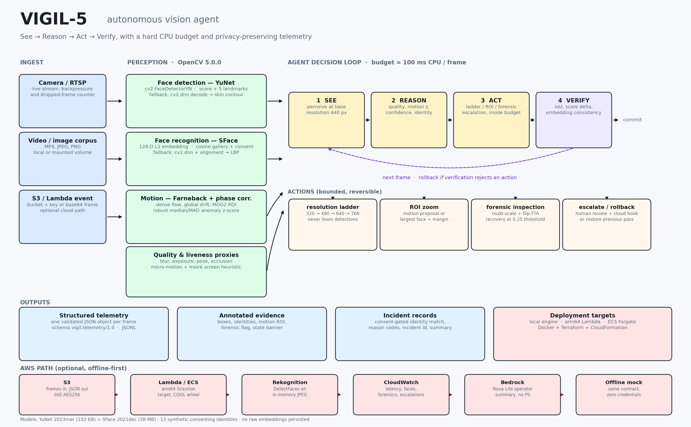

# VIGIL-5

Autonomous, budget-aware vision agent built on OpenCV 5 for Track 07 of the
OpenCV AI Competition 2026 (powered by AWS).

VIGIL-5 is not a fixed detector with a UI. It runs a closed loop —
**SEE → REASON → ACT → VERIFY** — and spends compute only when the current view
is not good enough: a resolution ladder, ROI zoom, forensic re-scan, rollback
when verification fails, and human escalation after persistent ambiguity. Each
frame emits one validated JSON record.



## Quick start

The project runs on a plain Python 3.10+ interpreter with OpenCV 5, NumPy,
Pydantic, psutil and matplotlib. On this build host those live in a shared
library directory; no virtualenv is created or required.

```bash
cd "/home/pope/Desktop/gpu /hackathons/07-opencv-ai-competition-2026"

python3 -c "import cv2; print(cv2.__version__)"   # expect 5.0.0
```

Models are loaded from `data/models/`:

- `face_detection_yunet_2023mar.onnx` (YuNet, ~228 KB)
- `face_recognition_sface_2021dec.onnx` (SFace, ~37 MB)

If a model file is missing, perception degrades to the DNN manual decode and
then to classical fallbacks; the backend name in telemetry says which path ran.

### Run the demo

```bash
# composes the clip, enrolls the gallery, runs the agent, writes the MP4
python3 src/generate_demo_video.py \
  --out data/demo/demo.mp4 \
  --annotated-out outputs/demo_annotated.mp4 \
  --telemetry outputs/telemetry/demo.jsonl \
  --summary outputs/demo_summary.json
```

Or re-annotate an existing clip only:

```bash
python3 -m src.engine \
  --video data/demo/demo.mp4 \
  --gallery data/demo/gallery \
  --out outputs/demo_annotated.mp4 \
  --telemetry outputs/telemetry/demo.jsonl \
  --summary outputs/demo_summary.json
```

The clip is 12 s / 288 frames, 640×360, with scripted occlusion, fast entry,
low light and blur. See `outputs/demo_notes.md` for the timeline, event windows
and the annotated-video legend.

### Run on images

```bash
python3 -m src.engine \
  --images data/samples/faces \
  --out outputs/sample_annotated \
  --telemetry outputs/telemetry/samples.jsonl
```

## Benchmarks

```bash
python3 benchmarks/run_eval.py
```

Three repetitions per timing block; the least-contended pass by CPU p50 is
reported alongside the observed spread. Writes:

- `outputs/benchmarks.json` — authoritative metrics and environment
- `outputs/benchmarks.csv` — flat table
- `logs/experiments.tsv` — append-only experiment log

Headline results on the build host (x86_64, 4 pinned cores, OpenCV threads = 1,
final run 2026-10-22, load average 47.26):

| Metric | Result |
|---|---|
| Detection ROC-AUC | 0.9917 |
| Detection precision / recall / F1 | 1.000 / 0.983 / 0.992 |
| Detection CPU p50 / p95 | 11.68 / 13.24 ms (85.2 CPU FPS) |
| Recognition ROC-AUC | 1.000 |
| Full agent wall FPS | 20.22 (31.15 on an earlier low-load run) |
| Full agent CPU p50 / p95 | 45.04 / 100.48 ms |
| Process peak RSS | 730.6 MB |
| Event recall (full vs static) | 1.00 vs 0.00 |

Full tables, caveats and rubric mapping: `outputs/DEVPOST_SUBMISSION.md`.

## One-command reproduction

```bash
bash scripts/run_all.sh        # tests + benchmark + annotated demo + local COOL levers
make all                       # equivalent
bash scripts/run_all.sh --with-arm64   # adds the QEMU aarch64 probe (emulated)
```

## Tests

```bash
PYTEST_DISABLE_PLUGIN_AUTOLOAD=1 python3 -m pytest -p no:cacheprovider
```

Plugin autoload is disabled because the shared library path contains an
unrelated third-party plugin. The suite needs only pytest. Current status:
**61 passed**.

## Configuration

Defaults live in `src/config.py`; a JSON file via `--config` / `VIGIL_CONFIG`
or `VIGIL_*` environment variables override them. Useful knobs:

| Variable | Meaning |
|---|---|
| `VIGIL_BASE_RESOLUTION` | Initial detection width (default 320) |
| `VIGIL_LATENCY_BUDGET_MS` | Per-frame CPU-time budget |
| `VIGIL_ENABLE_FORENSICS` | Enable forensic re-scan |
| `VIGIL_THREADS` | OpenCV thread count (default 1) |
| `VIGIL_STORE_EMBEDDINGS` | Store raw embeddings in telemetry (default off) |
| `VIGIL_AWS_ENABLED`, `VIGIL_AWS_MOCK` | Enable AWS path / force offline mock |

## Layout

```
src/
  config.py            typed configuration + env/JSON overrides
  telemetry.py         Pydantic vigil.telemetry/1.0 records
  engine.py            CLI + video/image runtime
  cloud.py             AwsCloud / OfflineCloud
  perception/          face, motion, quality
  agent/agent.py       SEE → REASON → ACT → VERIFY loop
  generate_demo_video.py  clip composer + agent annotation (writes outputs/demo_annotated.mp4)
benchmarks/run_eval.py           detection, recognition, agent, threads, dispatch
benchmarks/cool_local.py         measured local optimisation levers
benchmarks/arch_probe.py         same probe on x86_64 and aarch64
aws/                   Lambda, arm64/x86 images, ECS, Terraform, CloudFormation
tests/                 61 unit/integration/asset tests
outputs/               report, benchmarks, demo, telemetry, diagram, COOL evidence
scripts/               run_all.sh, arm64 emulation, evidence builder, architecture diagram
```

## AWS / COOL status

`aws/` contains a working offline-capable Lambda handler, arm64 and x86
container definitions, ECS task definitions, Terraform and CloudFormation.
Live deployment and Graviton/COOL numbers are **not claimed**: this environment
has no AWS credentials and no COOL entitlement. `outputs/cool_evidence.json`
reports `status: unavailable` with the probe that established it, the measured
x86 levers, a real aarch64-under-QEMU functional run, and an explicitly
simulated Arm model. See `aws/README.md` for the deployment and evidence
commands, and `scripts/run_arm64_emulated.sh` for the local aarch64 path.

## Data and licences

Demo/eval imagery is synthetic, built from licence-clean Wikimedia portraits
and OpenCV samples; attribution is in
`data/samples/faces/external_manifest.json`. Gallery consent is recorded in
`data/demo/gallery/consent.json`. Legacy work (`fdv`, `DeepDir-FaceScan`) was
reviewed read-only and not modified. See section 10 of the submission report
for full attribution and AI-assistance disclosure.
